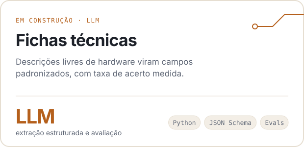
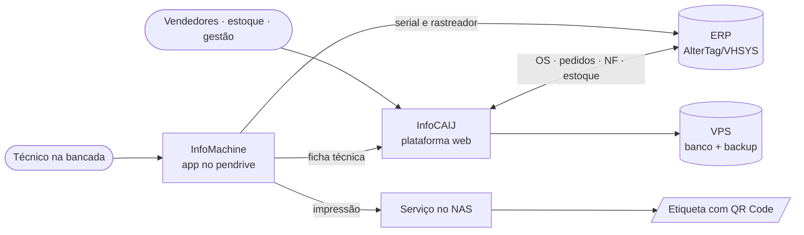

<picture>
  <source media="(prefers-color-scheme: dark)" srcset="assets/banner-dark.svg">
  
</picture>

  
  
  

<picture>
  <source media="(prefers-color-scheme: dark)" srcset="assets/stats-dark.svg">
  
</picture>

## Projetos

<table>
  <tr>
    <td width="50%">
      <a href="https://github.com/VitorTosti/infocaij-case-study">
        <picture>
          <source media="(prefers-color-scheme: dark)" srcset="assets/card-infocaij-dark.svg">
          
        </picture>
      </a>
    </td>
    <td width="50%">
      <a href="https://github.com/VitorTosti/infomachine">
        <picture>
          <source media="(prefers-color-scheme: dark)" srcset="assets/card-infomachine-dark.svg">
          
        </picture>
      </a>
    </td>
  </tr>
  <tr>
    <td width="50%">
      <a href="https://github.com/VitorTosti/CoreUFABC">
        <picture>
          <source media="(prefers-color-scheme: dark)" srcset="assets/card-coreufabc-dark.svg">
          
        </picture>
      </a>
    </td>
    <td width="50%">
      <picture>
        <source media="(prefers-color-scheme: dark)" srcset="assets/card-fichas-dark.svg">
        
      </picture>
    </td>
  </tr>
</table>

## Por dentro do InfoMachine

<table>
  <tr>
    <td width="33%"></td>
    <td width="33%"></td>
    <td width="33%"></td>
  </tr>
  <tr>
    <td align="center">Andamento do atendimento</td>
    <td align="center">Testes de hardware</td>
    <td align="center">Etiqueta antes da impressão</td>
  </tr>
</table>

## Como os sistemas se conectam

## Decisões técnicas

<b>InfoCAIJ</b> · da mensagem no WhatsApp para uma fila com 8 etapas

 

- **Quantidade vira unidade na entrada.** "4 notebooks" viram quatro itens, cada um com serial, OS, técnico e histórico próprios.
- **Estado técnico separado do comercial.** Uma máquina pode estar entregue na bancada e devolvida no comercial sem regras contraditórias, e o histórico sobrevive à revenda.
- **Respostas antigas do ERP são descartadas.** A consulta da OS dispara 400 ms após a digitação, e uma resposta atrasada não sobrescreve a atual.
- **Conciliação sem palpite.** 8.207 movimentações de estoque comparadas por serial; casos ambíguos vão para revisão manual.
- **Migração com caminho de volta.** Do computador local para uma VPS, com hash do banco, ambiente de teste e plano de retorno.

[Estudo de caso completo →](https://github.com/VitorTosti/infocaij-case-study)

<b>InfoMachine</b> · leitura automática como sugestão, não como verdade

 

- **Todo campo lido pode ser corrigido.** BIOS e Windows erram tipo de disco e memória; o técnico confirma antes de imprimir.
- **A decisão ambígua fica com quem está com a máquina.** Mais de um rastreador para a mesma serial vira uma escolha, não um palpite.
- **Atualização verificável.** Pacotes no NAS com SHA-256 e backup antes da troca, para que todos os pendrives rodem a mesma versão.
- **Diagnóstico por camada.** A falha de impressão é separada entre NAS, publicação do QR e impressora.

[Repositório →](https://github.com/VitorTosti/infomachine)

<b>CoreUFABC</b> · regras acadêmicas com fonte e teste

 

- **Parser tolerante ao PDF.** Junta linhas quebradas do histórico do SIGAA e normaliza para um schema JSON.
- **Métricas com fonte normativa.** CR, CA e CPk seguem o Guia da Graduação; a métrica própria é marcada como tal.
- **Privacidade no relato de erro.** O relato anônimo mantém só a estrutura da linha, sem nome, RA ou conceitos.

[Repositório →](https://github.com/VitorTosti/CoreUFABC)

<b>Como trabalho</b>

 

1. Levanto o problema com quem vai usar: regras, exceções e o que conta como pronto.
2. Implemento com assistentes de código, como o Codex, revisando cada mudança.
3. Escrevo testes para o comportamento que importa antes de publicar.
4. Valido no uso real e itero a partir do que acontece na operação.

## Em construção

| Projeto | Objetivo |
|:--|:--|
| **Extração estruturada de fichas técnicas** | Descrições livres de hardware em campos padronizados, com validação de esquema e taxa de acerto medida |
| **Laboratório de avaliação de prompts** | Prompts e modelos comparados na mesma tarefa, com dataset fixo e análise de erros |
| **Assistente com respostas fundamentadas** | Respostas a partir de documentos técnicos, com fonte citada e recusa sem evidência |

## Ferramentas

  

