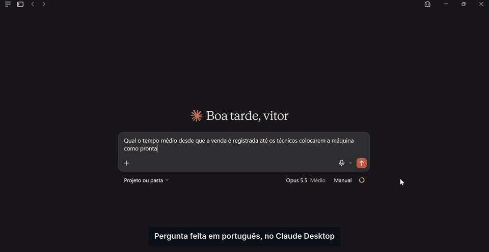
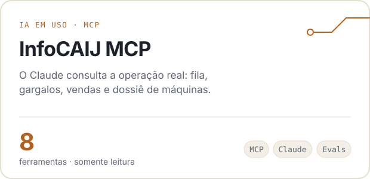
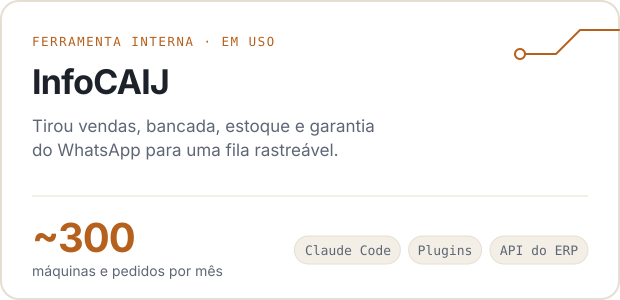
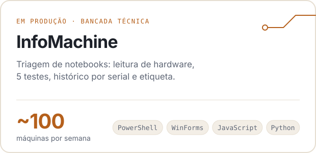
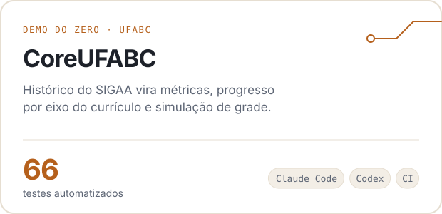
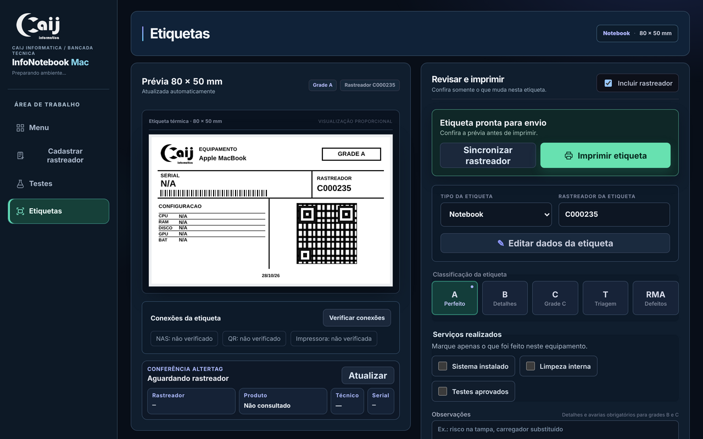
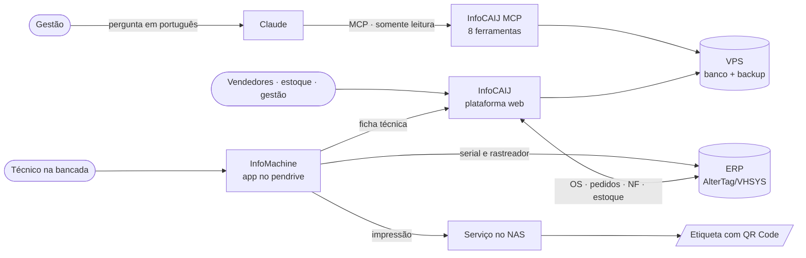

<picture>
  <source media="(prefers-color-scheme: dark)" srcset="assets/banner-dark.svg">
  
</picture>

  <a href="https://www.linkedin.com/in/vitortosti/"><picture><source media="(prefers-color-scheme: dark)" srcset="assets/btn-linkedin-dark.svg"></picture></a>
  <a href="https://www.ufabc.edu.br/"><picture><source media="(prefers-color-scheme: dark)" srcset="assets/btn-ufabc-dark.svg"></picture></a>
  <picture><source media="(prefers-color-scheme: dark)" srcset="assets/btn-local-dark.svg"></picture>

<picture>
  <source media="(prefers-color-scheme: dark)" srcset="assets/stats-dark.svg">
  
</picture>

## Destaque: a operação respondendo em português

Construí um servidor **MCP** que conecta o InfoCAIJ ao Claude. A gestão pergunta "onde a fila trava?" ou "quanto tempo da venda até a máquina ficar pronta?" e recebe a resposta calculada a partir do banco real, sem abrir telas nem montar planilhas. Ele só lê, nunca escreve, e nenhuma ferramenta devolve dados de clientes.

  <a href="https://github.com/VitorTosti/infocaij-mcp"><picture><source media="(prefers-color-scheme: dark)" srcset="assets/btn-projeto-dark.svg"></picture></a>

## Projetos

<table>
  <tr>
    <td width="50%">
      <a href="https://github.com/VitorTosti/infocaij-mcp">
        <picture>
          <source media="(prefers-color-scheme: dark)" srcset="assets/card-mcp-dark.svg">
          
        </picture>
      </a>
    </td>
    <td width="50%">
      <a href="https://github.com/VitorTosti/infocaij-case-study">
        <picture>
          <source media="(prefers-color-scheme: dark)" srcset="assets/card-infocaij-dark.svg">
          
        </picture>
      </a>
    </td>
  </tr>
  <tr>
    <td width="50%">
      <a href="https://github.com/VitorTosti/infomachine">
        <picture>
          <source media="(prefers-color-scheme: dark)" srcset="assets/card-infomachine-dark.svg">
          
        </picture>
      </a>
    </td>
    <td width="50%">
      <a href="https://github.com/VitorTosti/CoreUFABC">
        <picture>
          <source media="(prefers-color-scheme: dark)" srcset="assets/card-coreufabc-dark.svg">
          
        </picture>
      </a>
    </td>
  </tr>
</table>

## Como avalio o que construo com IA

Construo com Claude Code, Codex e n8n. O que separa uma demo de algo que se coloca em produção é testar com o modelo e com dados reais, achar onde falha e corrigir com um teste que impede a volta. Dois exemplos do InfoCAIJ MCP:

| | O que aconteceu | O que mudei |
|:--|:--|:--|
| **Teste com o modelo** | Numa sessão real, o Claude respondeu certo, mas avisou que não sabia se as devoluções eram contadas pela data da venda ou da devolução. | A descrição da ferramenta passou a dizer qual data define o período. A dúvida sumiu na resposta seguinte. |
| **Teste com dados reais** | No banco real, o gargalo apontado tinha mediana de 0,8 h. O problema verdadeiro era outra etapa, em que a maioria passava rápido, mas 10% esperavam mais de 3 dias. | O gargalo passou a ser a etapa com mais horas somadas. Um teste reproduz a cauda longa. |

## Por dentro do InfoMachine

<table>
  <tr>
    <td width="33%"></td>
    <td width="33%"></td>
    <td width="33%"></td>
  </tr>
  <tr>
    <td align="center">Andamento do atendimento</td>
    <td align="center">Testes de hardware</td>
    <td align="center">Etiqueta antes da impressão</td>
  </tr>
</table>

## Como os sistemas se conectam

## Decisões técnicas

<b>InfoCAIJ MCP</b> · ferramentas de negócio, não SQL livre

 

- **Somente leitura em duas camadas.** O banco é aberto em modo leitura pelo driver e a conexão recusa escrita; um teste confere que o arquivo não muda.
- **Nenhum dado de cliente.** Nenhuma consulta seleciona nome, e-mail ou telefone; um teste planta dados falsos e prova que nada vaza.
- **Cada ferramenta responde a uma pergunta da operação**, com argumentos validados. Um "execute este SQL" seria mais flexível e deixaria o modelo ler qualquer tabela.
- **O tempo por etapa não existe no banco.** O servidor reconstrói a linha do tempo de cada máquina a partir do histórico de mudanças de status.
- **Zero dependências.** O protocolo está implementado direto, em TypeScript que o Node roda sem build.

[Repositório →](https://github.com/VitorTosti/infocaij-mcp)

<b>InfoCAIJ</b> · da mensagem no WhatsApp para uma fila com 8 etapas

 

- **Quantidade vira unidade na entrada.** "4 notebooks" viram quatro itens, cada um com serial, OS, técnico e histórico próprios.
- **Estado técnico separado do comercial.** Uma máquina pode estar entregue na bancada e devolvida no comercial sem regras contraditórias, e o histórico sobrevive à revenda.
- **Respostas antigas do ERP são descartadas.** A consulta da OS dispara 400 ms após a digitação, e uma resposta atrasada não sobrescreve a atual.
- **Conciliação sem palpite.** 8.207 movimentações de estoque comparadas por serial; casos ambíguos vão para revisão manual.
- **Migração com caminho de volta.** Do computador local para uma VPS, com hash do banco, ambiente de teste e plano de retorno.

[Estudo de caso completo →](https://github.com/VitorTosti/infocaij-case-study)

<b>InfoMachine</b> · leitura automática como sugestão, não como verdade

 

- **Todo campo lido pode ser corrigido.** BIOS e Windows erram tipo de disco e memória; o técnico confirma antes de imprimir.
- **A decisão ambígua fica com quem está com a máquina.** Mais de um rastreador para a mesma serial vira uma escolha, não um palpite.
- **Atualização verificável.** Pacotes no NAS com SHA-256 e backup antes da troca, para que todos os pendrives rodem a mesma versão.
- **Diagnóstico por camada.** A falha de impressão é separada entre NAS, publicação do QR e impressora.

[Repositório →](https://github.com/VitorTosti/infomachine)

<b>CoreUFABC</b> · regras acadêmicas com fonte e teste

 

- **Parser tolerante ao PDF.** Junta linhas quebradas do histórico do SIGAA e normaliza para um schema JSON.
- **Métricas com fonte normativa.** CR, CA e CPk seguem o Guia da Graduação; a métrica própria é marcada como tal.
- **Privacidade no relato de erro.** O relato anônimo mantém só a estrutura da linha, sem nome, RA ou conceitos.

[Repositório →](https://github.com/VitorTosti/CoreUFABC)

## Em construção

| Projeto | Problema de negócio | Como |
|:--|:--|:--|
| **Agente de status** | Vendedores ainda perguntam à bancada se a máquina do pedido está pronta | Agente em n8n que reusa as ferramentas do InfoCAIJ MCP e responde ao vendedor; medido por perguntas resolvidas sem intervenção humana |
| **Fichas técnicas** | Planilhas de lote chegam com descrições de hardware fora de padrão | Extração estruturada com LLM, validação de esquema e taxa de acerto medida em um conjunto rotulado |

## Ferramentas

  

